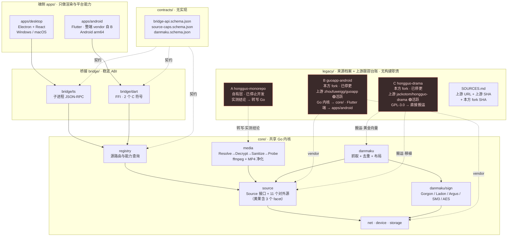
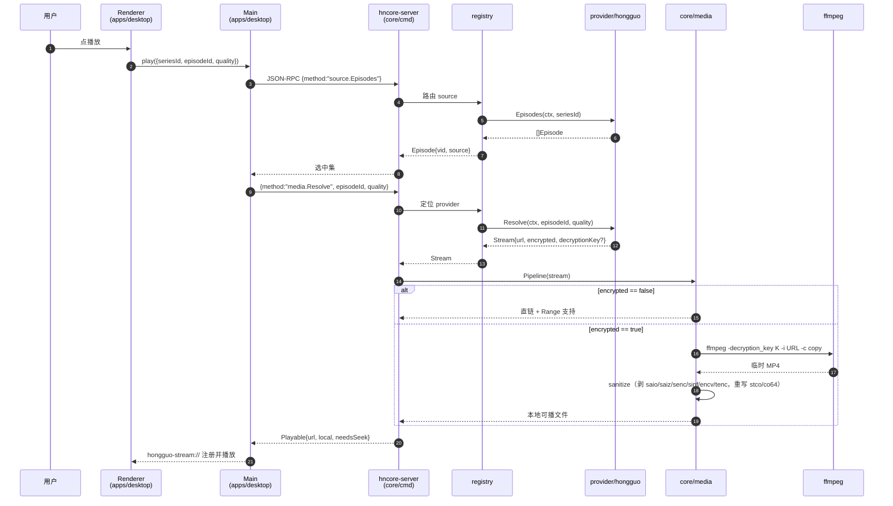
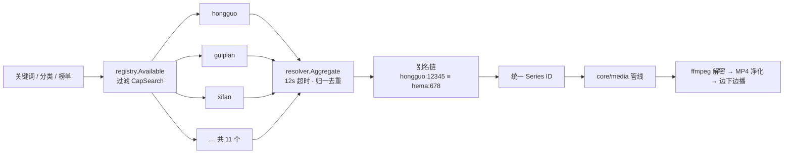
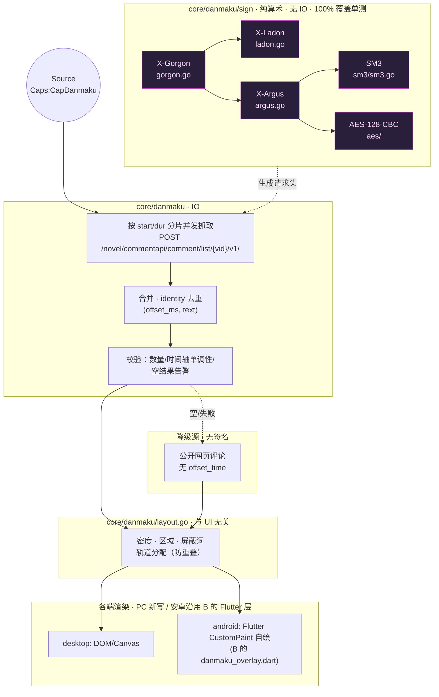

# hongguo-next 架构设计

> 状态：草案 v5 · 日期：2026-10-15
> **本版修正（v5）：B 链路（`guoapp`）许可定性已决，全文去掉"待授权"框架。** 版权人明确决定：**直接采用**上游未声明许可的 B 链路来源，代价是以**完整、如实的署名声明 + 合规响应通道**承担合规责任（`NOTICE` 第三节）。据此本文**删除全部"待授权 / 需取得许可才能用 / 许可前置阻塞"性质的表述**，一律改为已决事实：① §0 第 2、5 条重写；② §1.2 授权范围与来源表 B 行同步；③ §3.2 #19（`B/NOTICE` 并入方式）改为"已决 + 全链署名 + 响应通道 + 使用者自评"；④ §3.4 许可与合规新增 **B 链路定性段落（3.4.1）**、**合规响应通道（3.4.2）**、**使用者自评提示（3.4.3）**；⑤ §7 路线图与 §8 风险表（"上游第三方权利人主张权利"一行）去掉"索取许可"，改为直接采用 + 署名 + 响应通道。
> **上一版修正（v4）：来源结构的语义改正。** 原文「三个老仓均已停止开发」**是错的**。核实结论：**只有自有层 `dawei233/hongguo-monorepo` 真正停止开发**（版权人自有项目，非 fork，最后推送 2026-10-11）；`dawei233/guoapp-android` 与 `dawei233/hongguo-drama` 是**本方 fork，仅"由本方停止维护"**，它们的上游 `zhoufuweigg/guoapp` 与 `jackotom/hongguo-drama` **仍在活跃开发**。据此改：① §1.2 改为「**上游 / 本方 fork / 自有**」三层表述，并给出**上游仓库链接**与两侧 commit SHA；② **新增 §1.3「上游跟踪义务」**（原 §1.3 顺延为 §1.4），定义 `legacy/SOURCES.md` 的上游跟踪字段、评估节奏与回移判据；③ §3.4 许可表与署名声明的授权范围**据实收窄**（上游是第三方仓，本仓不对其主张许可）；④ §8 风险表同步更新。
> **上一版修正（v3）**：① **安卓端技术栈判断错误已更正** —— `apps/android` = **B 的 Flutter 应用整端 vendor**（`lib/` 84 文件 / 30558 行 + `android/ios/windows` 平台层 + `bridge/dart` FFI 保留），**不是**"Media3 + Gradle 重建"；被废弃的是旧 monorepo（A）的 Java WebView + Media3 方案，不是 Flutter。② **PC 端播放器更正**为 `@videojs/react` 10.x 的 `createPlayer({features})` 组合式 API（npm 包 `video.js` 在 v10 已是墓碑包）。
> 适用仓库：`github.com/dawei233/hongguo-next`（本地为 `/workspace/红果/hongguo-next`）
> 前提：来源仓分三层 —— **自有层** `hongguo-monorepo`（版权人自有项目，**已停止开发**，唯一真正停止的一个）、**本方 fork 层** `dawei233/guoapp-android` 与 `dawei233/hongguo-drama`（由本方**停止维护**）、以及**上游层** `zhoufuweigg/guoapp` 与 `jackotom/hongguo-drama`（**第三方仓，仍在活跃开发**，见 §1.3）。其代码按本仓许可策略**直接并入本仓统一维护**，自有层与本方 fork 层仅作历史存档。

---

## 0. 一句话结论（先读这段）

1. **本仓不做"三合一仓库"的形态合并，但做"代码归一"**：共享 Go 内核 + 双端壳 + 站源插件 + 弹幕内核，来源仓中可用的实现**直接并入** `core/` 统一维护，不再有"构建期外部 checkout"或"零代码复制"这类隔离层。
2. **全仓统一 GPL-3.0**。授权范围必须说准：版权人对**自有层** `hongguo-monorepo`（`license=NONE`、非 fork）与**本方两个 fork 中由本人新增/修改的部分**享有版权并授权按 GPL-3.0 并入；`hongguo-drama` 的 fork 基线来自同为 **GPL-3.0** 的 `jackotom/hongguo-drama`（同许可，搬运即合规）；而 `guoapp-android` 的 fork 基线来自**未声明许可证**的 `zhoufuweigg/guoapp`（**第三方仓，仍在活跃开发**）—— **该部分仍是无许可的第三方代码，本仓仅作署名与来源记录，既不主张授权、也不声称已获授权**（§3.4.1、`NOTICE` 第三节）。`LICENSE` 已就位（仓库根）。
3. **决定性事实：本仓的 GPL-3.0 不是新引入的约束，而是与既有分发现实一致。** `hongguo-drama` 已捆绑 **ffmpeg 9.0.2 + x264**，构建为 **GPLv3-or-later**（`build/ffmpeg/WINDOWS-NOTICE.txt`、`THIRD-PARTY-NOTICES.md`），因含 x264 无法走 LGPL —— **现有分发物本来就是 GPLv3 二进制**。既然产品线已经在分发 GPLv3 二进制，把源码也统一为 GPL-3.0 不增加任何新义务，却消掉了全部许可隔离工作。
4. **搬运策略从"重写/零复制"整体改为"原样搬运或最小改造"**：B 的 24035 行 Go 内核（121 文件 / 27 测试）直接 vendor 进 `core/`（仅删 `buildAllSources` 门控）；C 的 `xifan.js`/`hema.js`（302 行）直接移植；C 的弹幕签名与其黄金向量测试直接搬用（不再自生成向量）。只有跨越语言边界的地方（A 的 Python → Go）才需要转写。
5. **许可事项已决：B 链路直接采用 + 完整署名，且不存在待办的授权前置。** B 链路（`guoapp`）的上游① `zhoufuweigg/guoapp` 与上游②「鱼佬」的短剧库 APP **均未声明许可证**。版权人**已明确决定直接采用**该来源，代价是以**完整、如实的署名声明 + 合规响应通道**承担合规责任（定性与文本见 `NOTICE` 第三节、本文 §3.4.1）。因此：① **不再有"向上游索取许可 / 发许可邮件"这类待办事项**，它既不是开工前置、也不是发布前置；② 原 M0「补 LICENSE + 发许可邮件」整段取消，工期净减少约 5–7 人日的隔离工作；③ 最大的不确定性（上游是否回信）直接归零 —— 合规责任由**署名 + 响应通道**承担，不依赖上游回应。
6. **安卓端不是"重建"，而是"整端 vendor"**：安卓版**直接采用 B 的 Flutter 应用**（`github.com/dawei233/guoapp-android`，用户明确指示"安卓版用他的"）。其 `lib/`（**84 文件 / 30558 行 Dart**）+ `android/`/`ios/`/`windows/` 平台层**原样并入 `apps/android`**；B 的 Go 内核本就通过 `native/bridge/main.go` 的 FFI（2 个 C 符号）供该 Flutter 端调用，Dart 侧绑定即 `lib/core_bridge.dart`，所以桥接层原样保留即可。**被废弃的是旧 monorepo（A）的 Java WebView + Media3 方案，不是 Flutter。** 本文此前把 `apps/android` 写成"Media3 + Gradle 重建"是判断错误，已全文更正。
7. **PC 端播放器用 `@videojs/react` 10.x**：npm 包 `video.js` 在 v10 已是**墓碑包**（`videojs()` / `registerPlugin` / `registerComponent` 全部 `throwLegacyError('VJS8_LEGACY_*')`，README 指向 `@videojs/html` 与 `@videojs/react`）。本仓 PC 端采用 **`@videojs/react` 10.x 的 `createPlayer({features: [...]})` 组合式 API**（返回 `{ Player, usePlayer, useMedia }`），**禁止**按 video.js 8 教程写 `videojs('my-video')` 实例 + `registerPlugin` 全局注册。HLS 由 v10 自带的 `@videojs/spf` 引擎承担，hls.js 仅作可选 adapter（`<HlsJsVideo/>`）。详见 `DESIGN-SYSTEM.md` §1.3。
8. **本仓从两个"活着的"上游 vendor 代码，因此新增一项长期义务：上游跟踪。** `zhoufuweigg/guoapp`（2026-09-26，916 ★，`license=NONE`）与 `jackotom/hongguo-drama`（2026-10-15，233 ★，GPL-3.0）**均未归档、仍在开发**，而本方的两个 fork 已停更 —— 本仓的 vendored 快照从并入那天起就在落后。因此：① 每个 vendor 来源必须在 `legacy/SOURCES.md` 记录**上游仓库 URL + 上游 commit SHA + 本方 fork 的 SHA**；② 按固定节奏评估上游提交、**按需定向回移**（站源失效修复、播放修复优先）；③ 本仓**不以 merge/rebase 上游的方式同步**（本仓是整合重写，不是 fork 的直接延续），只做定向 cherry-pick。完整规则见 **§1.3**。

---

## 1. 命名与仓库边界

### 1.1 命名

| 项 | 取值 | 说明 |
|---|---|---|
| 仓库名 | `hongguo-next` | 已建，GitHub `dawei233/hongguo-next` |
| 产品名 | 红果 Next / `HongguoNext` | 不再用「漫剧 / 下载器 / 鉴」任何一个老名字，避免与来源仓混淆 |
| Go module | `github.com/dawei233/hongguo-next/core` | 唯一内部可 import 前缀 |
| 包前缀 | `hncore/` 短名仅用于 `package` 内引用 | 不做 Go 包重命名，目录即 module 路径 |
| Flutter/Dart 包名 | `hongguo_next` | 与 B 的 `duanju_app` 区分 |
| Electron appId | `com.dawei233.hongguo.next` | 与 `com.hongguo.manju`（A）、B 的签名配置区分 |
| 版本线 | `0.x`（架构冻结前），`1.0` 定义为"三源同时可用且 CI 全绿" | |

### 1.2 本仓与来源仓的关系（上游 / 本方 fork / 自有 三层）

**结论：来源代码直接并入本仓统一维护，不使用 submodule，也没有构建期外部 checkout。**

⚠ **先纠正一处错误表述**：本文此前写"三个老仓均已停止开发"，**不成立**。来源必须分三层看，**只有自有层真正停止了开发**：

| 层 | 仓库 | 状态（核实于 2026-10-15） | 许可 | 角色 |
|---|---|---|---|---|
| **上游** | [zhoufuweigg/guoapp](https://github.com/zhoufuweigg/guoapp) | 🟢 **仍在开发**（最后推送 2026-09-26 · 916 ★ · 10 open issues · 未归档） | `license=NONE`（**未声明**） | 安卓端 / Go 内核的原始上游 |
| **上游** | [jackotom/hongguo-drama](https://github.com/jackotom/hongguo-drama) | 🟢 **仍在开发**（最后推送 2026-10-15 · 233 ★ · 19 open issues · 未归档） | **GPL-3.0** | 站源 / 弹幕签名 / 黄金向量的原始上游 |
| 本方 fork | [dawei233/guoapp-android](https://github.com/dawei233/guoapp-android) | ⚪ **已停止由本方维护**（`android-only` HEAD = `ff3bad2`；上游 `main` = `0e60928` 已被完全包含，另加本方 57 个提交） | `license=NONE` | 安卓端 / Go 内核的实现来源 |
| 本方 fork | [dawei233/hongguo-drama](https://github.com/dawei233/hongguo-drama) | ⚪ **已停止由本方维护**（`main` HEAD = `c884fab`；上游 `main` = `5a12c88` 是其祖先） | **GPL-3.0** | 西饭/河马站源、弹幕签名与黄金向量来源 |
| **自有** | [dawei233/hongguo-monorepo](https://github.com/dawei233/hongguo-monorepo) | ⚫ **已停止开发**（最后推送 2026-10-11 · 非 fork） | `license=NONE` | PC 端拉流 / 解密 / MP4 净化的实测能力来源 |

**"停止开发"的准确含义**：`hongguo-monorepo` 是版权人自有项目，已冻结，**不再接受改动**；两个 fork **只是本方不再维护**，其上游仍在出提交 —— 所以本仓不是"从一个死掉的生态里搬东西"，而是**从两个活跃上游的快照里 vendor，并对其负有跟踪义务（§1.3）**。

**授权范围（说准，不含糊）**：

- **自有层 A** `hongguo-monorepo`：版权人本人所有、非 fork、`license=NONE` → 版权人有权以 GPL-3.0 重新授权。
- **本方 fork C** `hongguo-drama`：fork 基线来自同为 GPL-3.0 的 `jackotom/hongguo-drama` → 两端同许可，搬运与再分发即合规（无需再授权）。
- **本方 fork B** `guoapp-android`：版权人授权的是**本人在该 fork 中新增/修改的部分**（本方 57 个提交）。其 fork 基线来自**未声明许可证**的 `zhoufuweigg/guoapp`（再往上还有**无法核实的**上游②「鱼佬」的短剧库 APP），**该部分仍是无许可的第三方代码** —— 本版权人**已决定直接采用**，本仓对其**仅作署名与来源记录：既不主张授权，也不声称已获授权**（§3.4.1，完整声明见 `NOTICE` 第三节），并保留配合权利人处理的渠道（§3.4.2）。

| 来源 | 层 | 许可现状 | 本仓的授权依据 | 并入方式 |
|---|---|---|---|---|
| A `hongguo-monorepo` | 自有 | `license=NONE`（非 fork） | ✅ 版权人有权以 GPL-3.0 授权 | Python 逻辑 → 转写为 Go 进 `core/media`；实测结论作为 ADR 固化 |
| B `guoapp-android` | 本方 fork | `license=NONE`，fork 自无许可的上游（再往上「鱼佬」一链**无法核实**） | ⚠ **已决：直接采用**；仅本人新增/修改部分可授权，上游派生部分**仅署名记录，不主张、不声称已获授权**（§3.4.1） | Go 内核 **原样 vendor 进 `core/`**（仅删 edition 门控）；**Flutter 端（`lib/` + `android/ios/windows` 平台层）原样 vendor 进 `apps/android`** |
| C `hongguo-drama` | 本方 fork | **GPL-3.0**，fork 自同为 GPL-3.0 的上游 | ✅ 同许可，搬运即合规 | xifan/hema、弹幕签名与向量测试 **直接搬运/移植** |
| B 上游 `zhoufuweigg/guoapp` | 上游 | `license=NONE`，**活跃** | ❌ **不并入**，仅溯源与跟踪 | 无（经 B 间接承接） |
| C 上游 `jackotom/hongguo-drama` | 上游 | **GPL-3.0**，**活跃** | ❌ **不并入**，仅溯源与跟踪 | 无（经 C 间接承接） |

具体做法：

- **B（`guoapp-android`）** → 其 `native/core/*.go`（121 文件 / 24035 行 / 27 个测试文件）**整体 vendor 进 `core/`**，保留原文件形态与测试，仅做两处最小改造：① module 路径统一为 `github.com/dawei233/hongguo-next/core`；② **删除 `app_build.go` 的 `buildAllSources` 门控**（见 §4.5）。不再需要 `legacy.lock.json`、`tools/legacy/fetch.py`，也不再需要"发行包不内置 `.so`"这种规避动作 —— APK 可以直接内置 `libhncore_android.so`。**同时，B 的 Flutter 应用端**（`lib/` 84 文件 / 30558 行 Dart、`android/`+`ios/`+`windows/` 平台层、`test/`+`integration_test/`+`test_driver/`）**整体 vendor 进 `apps/android`**，同样只做最小改造：① `pubspec.yaml` 包名 `duanju_app` → `hongguo_next`（依赖原样保留，含 `media_kit` / `video_player` / `ffmpeg_kit_flutter_new_min_gpl`）；② 主题层改为 `ThemeExtension` 令牌镜像（见 `DESIGN-SYSTEM.md` §6.1）；③ FFI 侧随 `core/` 改名对齐。**安卓端 UI 不重写**：B 的 Flutter 端就是安卓端本体，`lib/core_bridge.dart` 保留为 `dart:ffi` 绑定（2 个 C 符号 ⇄ `bridge/go/main.go`）。被废弃的是**旧 monorepo（A）的 Java WebView + Media3 方案**，不是 Flutter。**注意：B 已停更而 `zhoufuweigg/guoapp` 仍在开发 → 本条 vendor 的是一份会过期的快照，须登记跟踪字段（§1.3）。**
- **C（`hongguo-drama`）** → 已是 GPL-3.0，与本仓同许可，**搬运即合规**。`xifan.js`/`hema.js`（135+167 行）移植进 `core/source/providers/`；`danmaku.js`/`danmaku-sign.js` 及其黄金向量测试（`danmaku-sign.test.cjs` + `scripts/fixtures/danmaku-sign-vectors.json`）直接搬用，作为本仓签名实现的**基准真值**。UI（`src/components/*`、`main.js`）仍然不搬 —— 这是产品决策（**PC 端要自己的 Electron/React UI**；安卓端 UI 沿用 B 的 Flutter 端，见 §3.2 #18），不是许可约束。**注意：C 已停更而其上游 `jackotom/hongguo-drama` 是三条上游里最活跃的一条（2026-10-15）→ 站源与接口修复会先到上游，本仓必须跟踪。**
- **A（`hongguo-monorepo`）** → 作者本人自有仓**且已停止开发**（无上游可跟踪），`mp4_sanitize.py`（300 行）与 `hongguo_core.py` 的 ffmpeg 解密段按原计划**转写为 Go**（这是语言迁移，不是许可绕行）；`liushen/flurl/*.py`（8.9 万行混淆产物）**仍然不搬** —— 因为 B 的 Go 签名实现已经可用，搬运混淆产物的收益为零。
- **来源仓仓库本身**：自有层与本方 fork 层保持只读冻结，作为历史参考与来源出处；**两个上游仓不冻结**（它们不由本方控制），只做**单向跟踪**（§1.3）。新代码一律进 `hongguo-next`。
- **保留 `legacy/` 目录**，但语义从"锁文件 + 外部检出"降级为"**来源档案**"：记录每个来源的 URL、参考 commit、搬了哪些文件、搬入路径，**以及上游仓库 URL 与上游 / 本方 fork 两侧的 commit SHA 与跟踪状态**。用于履行 GPL 的署名与来源可追溯义务，不承担任何构建职责。

`docs/legacy/*.md` 与 `NOTICE` 的写法相应调整：不再是"未复制任何代码"的免责声明，而是**如实记录来源链路与上游署名**（见 §3.4），并写明上游仍在开发这一事实。

### 1.3 上游跟踪义务

**为什么这是一条硬义务，而不是"有空再说"**：本仓的 `core/` 与安卓端分别 vendor 自 `zhoufuweigg/guoapp` 与 `jackotom/hongguo-drama` 的**快照**，而这两个上游**都在活跃开发**（前者 2026-09-26、后者 2026-10-15 仍有推送）。本方的两个 fork 已停更，因此：

- 上游的**站源失效修复**（接口域名/路径变更、参数调整）会先出现在上游，而本仓的对应 provider 还在用旧端点；
- 上游的**播放修复 / 签名调整**同理（弹幕签名与取址算法是唯一会**静默过期**的部分）；
- 本仓**不会**自动获得这些修复 —— 没人把它们搬回来，源就是坏的。

**1.3.1 记录义务：`legacy/SOURCES.md` 的字段**

每个 vendor 来源必须登记下列字段（上游 / 本方 fork 两侧都要有 SHA）：

| 字段 | 含义 | 必需 |
|---|---|---|
| `layer` | `upstream` / `fork` / `own` | ✅ |
| `repo` | 本方取用的仓库 URL（自有层或本方 fork） | ✅ |
| `repo_ref` | 本方取用时的 commit SHA（**不是分支名**，分支会移动） | ✅ |
| `upstream_repo` | **上游仓库 URL**（自有层写 `null`） | ✅ |
| `upstream_ref` | 取用时**上游 commit SHA**；用于日后算"落后了多少" | ✅ |
| `upstream_status` | `active` / `archived` / `no-upstream` + 最后核实日期 | ✅ |
| `license` | 许可状态原文（`NONE` 也要写，不做推断） | ✅ |
| `taken` / `modified` / `removed` | 搬入路径清单 / 本仓改动 / 删除项 | ✅ |
| `last_triaged` | 上次评估上游提交的日期 | ✅ |
| `backports` | 已回移的上游 commit 列表（SHA + 一句话理由） | ✅（可空数组） |

**可操作的记录格式示例**（`legacy/SOURCES.md`，B/C 两条各一份）：

```yaml
# legacy/SOURCES.md —— 来源档案 + 上游跟踪台账（人读；无构建职责）
B:
  layer: fork                      # 本方 fork，其上游活跃
  repo: https://github.com/dawei233/guoapp-android.git
  repo_ref: ff3bad2                # android-only 分支 HEAD（本方 57 个提交之首）
  upstream_repo: https://github.com/zhoufuweigg/guoapp.git
  upstream_ref: 0e60928            # 上游 main；已被 repo_ref 完全包含
  upstream_status: active          # 最后核实 2026-10-15：916★ / 10 open issue / 未归档
  license: NONE                    # 上游未声明许可证；本方仅授权自己新增/修改的部分
  taken:
    - native/core/**        → core/          # 121 文件 / 24035 行 / 27 测试
    - native/bridge/main.go → bridge/go/main.go
    - lib/** + android/ ios/ windows/ + test/ + integration_test/ + test_driver/
                            → apps/android/  # 84 dart 文件 / 30558 行，整端 vendor
  modified:
    - pubspec name: duanju_app → hongguo_next
    - theme layer → ThemeExtension<HongguoTokens>
  removed:
    - app_build.go buildAllSources 门控
  last_triaged: 2026-10-15
  backports: []                    # [{sha: <upstream-sha>, why: 站源失效修复, at: <date>}]

C:
  layer: fork
  repo: https://github.com/dawei233/hongguo-drama.git
  repo_ref: c884fab                # 本方 fork main HEAD
  upstream_repo: https://github.com/jackotom/hongguo-drama.git
  upstream_ref: 5a12c88            # 上游 main；是 repo_ref 的祖先
  upstream_status: active          # 最后核实 2026-10-15：233★ / 19 open issue / 未归档
  license: GPL-3.0                 # 与本仓同许可
  taken:
    - src/native/xifan.js, hema.js            → core/source/providers/{xifan,hema}
    - src/native/danmaku.js, danmaku-sign.js  → core/danmaku/**
    - scripts/fixtures/danmaku-sign-vectors.json → core/danmaku/testdata/vectors.json
    - src/native/licenses/*                   → third_party/drpys/
  last_triaged: 2026-10-15
  backports: []

A:
  layer: own                       # 版权人自有、已冻结、无上游
  repo: https://github.com/dawei233/hongguo-monorepo.git
  repo_ref: cfb1701
  upstream_repo: null
  upstream_ref: null
  upstream_status: no-upstream     # 非 fork；已停止开发（最后推送 2026-10-11）
  license: NONE                    # 自有仓，版权人以 GPL-3.0 授权
  taken:
    - nas-backend/mp4_sanitize.py        → core/media/{sanitize,boxes}.go
    - nas-backend/hongguo_core.py#1664-1905 → core/media/{ffmpeg,pipeline}.go
  last_triaged: n/a
  backports: []
```

**1.3.2 跟踪节奏与判据**

- **节奏**：每个里程碑（M1–M4）收口时做一次上游评估；非里程碑期间**每月一次**；上游出现安全/可用性相关的紧急性修复时不定期抽查。评估动作写入 `legacy/SOURCES.md` 的 `last_triaged`。
- **评估方式**：`git fetch` 上游后看 `upstream_ref..upstream/main` 的提交列表（可配合 `git log --oneline upstream/main ^<repo_ref>`）；对每条提交判断"是否触及本仓已 vendor 的路径"。
- **值得回移的判据（按优先级）**：
  1. **站源失效修复** —— 端点/域名/签名参数变更，直接影响某个 provider 能不能用；
  2. **播放修复** —— 拉流、解密、去广告、清晰度选择相关的修复；
  3. **弹幕签名调整** —— 与第 1 项并列最高优先级：这是唯一会**静默过期**的部分，回移须同步更新黄金向量与断言；
  4. **崩溃 / 内存 / 并发修复** —— 触及 `core/` 内被 vendor 的代码路径；
  5. **新站源或新特性** —— 仅在收益明确且与本仓 `Source` 接口相容时回移。
- **不值得回移**：与本仓产品决策冲突的改动（旧 monorepo 的 NAS 形态、被废弃的 A 端方案）、纯 UI/品牌改动（本仓 PC 端 UI 是新写的）、以及只服务上游特定打包形态的构建脚本改动。
- **回移方式**：`git cherry-pick -n <sha>` 后按本仓形态**改造并提交**（本仓已改 module 路径、删了门控，通常无法直接落地），在 `backports` 中登记该 SHA 与理由；回移后 **27 个 Go 测试与弹幕黄金向量断言必须全绿**。
- **明确不做的事**：**本仓不用 merge / rebase 上游的方式同步**。本仓是**整合重写**（`core/` 与 `apps/android` 都经过重命名、门控删除、契约对齐），不是任何 fork 的直接延续 —— 直接 merge 上游会带回早已删除的门控与被废弃的实现，并把上游历史灌进本仓。只做**定向 cherry-pick**。同理，本仓**不回推**上游（本仓的改动是整合后的形态，不适合上游）。

### 1.4 文档怎么写

```
docs/
├── ARCHITECTURE.md              # 本文：分层、依赖方向、边界
├── ADR/                          # 架构决策记录（每个 ADR 一个文件，编号递增）
│   ├── 0001-repo-boundary-and-legacy-integration.md
│   ├── 0002-source-plugin-model.md
│   ├── 0003-danmaku-signature-in-go.md
│   └── 0004-media-pipeline-decrypt-and-sanitize.md
├── legacy/                       # 来源档案：记录 URL / commit / 搬入路径与署名 + 上游跟踪台账
│   ├── SOURCES.md                # ★ 上游跟踪台账：上游 URL + 上游 SHA + 本方 fork SHA（§1.3）
│   ├── A-hongguo-monorepo.md     # 自有层（已停止开发，无上游）；v64 实测能力清单 + 关键实测结论
│   ├── B-guoapp-android.md       # 本方 fork（已停更）；上游 zhoufuweigg/guoapp（活跃，无许可）；搬入 core/ 的 Go 清单 + 搬入 apps/android 的 Flutter 清单、buildAllSources 门控
│   └── C-hongguo-drama.md        # 本方 fork（已停更）；上游 jackotom/hongguo-drama（活跃，GPL-3.0）；搬入清单（xifan/hema/弹幕签名与向量）
├── migration/
│   ├── mapping.md                # §3 的搬运映射表（可执行版）
│   └── phases.md                 # M1..M4 分批落地计划
└── contracts/
    ├── bridge-api.schema.json    # 主进程 ⇄ 内核 的 IPC 契约（唯一对外稳定面）
    └── danmaku.schema.json
```

`NOTICE`（仓库根）必须包含：来源链路（含**上游仓库链接**与"上游仍在开发"的事实）、每个来源的许可状态与上游署名、搬入本仓的文件清单、以及捆绑 ffmpeg/x264 的对应源码提供义务说明（见 §3.4）。

---

## 2. 架构设计

### 2.1 目录结构

```
hongguo-next/
├── README.md
├── LICENSE                        # GPL-3.0（已就位）
├── NOTICE                         # 来源链路（含上游链接）+ 上游署名 + 对应源码义务（见 §3.4）
├── legacy/                        # 来源档案（无构建职责）
│   ├── SOURCES.md                 # ★ 上游跟踪台账：来源 URL + 参考 commit + 上游 URL/SHA + 搬入清单 + backports（§1.3）
│   └── README.md                  # 档案说明
│
├── contracts/                     # 跨端契约（唯一对外稳定面，无实现）
│   ├── bridge-api.schema.json
│   ├── danmaku.schema.json
│   └── source-caps.schema.json
│
├── core/                          # ★ 共享 Go 内核：PC 与 Android 共用（vendor B 的 24035 行）
│   ├── go.mod                     # module github.com/dawei233/hongguo-next/core
│   ├── go.sum
│   ├── cmd/
│   │   ├── hncore-server/         # stdio JSON-RPC 服务端（PC 端拉起子进程用）
│   │   ├── hncore-vectors/        # 弹幕签名向量校验器（对齐 C 的黄金向量）
│   │   └── hncore-fixture/        # 抓取本地 fixture，喂单测
│   ├── registry/                  # 插件注册表 + 能力查询 + 路由
│   ├── source/                    # ★ 站源层
│   │   ├── source.go              # Source 接口、Caps 位、ID 编解码
│   │   ├── registry.go
│   │   ├── resolver.go            # 跨源聚合搜索 / 剧集去重 / 别名归一
│   │   ├── providers/             # 目录数 = §4.3 的 11 个对外源
│   │   │   ├── hongguo/           # B 的 app 签名 + catalog + playback + comment（原样搬入）
│   │   │   ├── huangguo/          # B 的 ai / video / 旧版（cloudfront）三个 facet 合并（原样搬入）
│   │   │   ├── guipian/
│   │   │   ├── hanxiaoquan/
│   │   │   ├── huangdou/
│   │   │   ├── huangju/
│   │   │   ├── yeguo/
│   │   │   ├── dsd/
│   │   │   ├── sorani/
│   │   │   ├── xifan/             # ★ 移植 C 的 xifan.js（135 行）
│   │   │   └── hema/              # ★ 移植 C 的 hema.js（167 行）
│   │   │                          # 注：黄果旧版是上面 huangguo/ 的 facet；legacy（旧版接口自动发现）
│   │   │                          # 是 huangguo 内的兜底机制，两者都不另立 provider 目录。
│   │   └── providers/*_test.go    # 含 B 的 27 个测试（原样保留）
│   ├── media/                     # ★ 媒体管线（承接 A 的实测能力）
│   │   ├── pipeline.go            # Resolve → Fetch → Decrypt → Sanitize → Probe
│   │   ├── ffmpeg.go              # ffmpeg -decryption_key K -i URL -c copy + faststart
│   │   ├── sanitize.go            # ★ MP4 净化（Go 转写 A 的 mp4_sanitize.py，300 行）
│   │   ├── boxes.go               # box 解析 / stco / co64 偏移重写
│   │   ├── hls.go
│   │   └── probe.go
│   ├── danmaku/                   # ★ 弹幕内核
│   │   ├── danmaku.go             # 分片抓取 + 合并 + identity 去重（移植 C 的 danmaku.js）
│   │   ├── webfallback.go         # 无签名的公开评论降级源
│   │   ├── layout.go              # 轨道布局（两端共享，保证视觉一致）
│   │   ├── sign/
│   │   │   ├── gorgon.go          # X-Gorgon
│   │   │   ├── ladon.go           # X-Ladon
│   │   │   ├── argus.go           # X-Argus
│   │   │   ├── sm3/sm3.go         # 纯 Go SM3
│   │   │   ├── aes/               # AES-128-CBC + PKCS#7
│   │   │   └── sign_test.go
│   │   └── testdata/vectors.json  # ★ 搬用 C 的 danmaku-sign-vectors.json 黄金向量
│   ├── device/                    # 设备注册 / 参数构造（对应 A 的 build_device_payload）
│   ├── storage/                   # 缓存 / 索引 / 追剧记录
│   └── net/                       # TLS 指纹、UA 池、重试、限速（B 的 tls-client/fhttp）
│
├── apps/
│   ├── desktop/                   # PC 端（Electron + React 19 + Vite）
│   │   ├── package.json
│   │   ├── electron-builder.yml
│   │   ├── src/main/              # 主进程：窗口、IPC、任务队列、子进程管理
│   │   ├── src/preload/           # contextBridge，暴露 window.hn
│   │   └── src/renderer/          # React 组件（新写；UI 是产品决策，不搬 C 的组件）
│   │                              # ★ 播放器：@videojs/react 10.x · createPlayer({features})
│   │                              #   （npm 包 video.js 在 v10 已是墓碑包，禁写 v8 的 videojs()）
│   └── android/                   # ★ 安卓端 = Flutter 应用，**整端 vendor 自 B**，不重建
│       ├── lib/                   # ★ Dart 层原样 vendor（B 的 84 文件 / 30558 行）
│       │   └── core_bridge.dart   #   保留 dart:ffi：2 个 C 符号 ⇄ bridge/go/main.go
│       ├── android/               # ★ Flutter 平台层：Gradle(KTS)、MainActivity.kt、
│       │                          #   AndroidManifest、res/、jniLibs/libhncore_android.so
│       ├── ios/ · windows/        # ⚠ 实测：B 仓这两个目录里**只有生成物**（Flutter/ephemeral、
│       │                          #   Generated.xcconfig、GeneratedPluginRegistrant），
│       │                          #   且被 B 自己的 .gitignore 全部排除 → 无工程文件可搬，
│       │                          #   本仓也不跟踪。首发非目标；要做需先 flutter create 生成工程。
│       ├── pubspec.yaml           # 包名 duanju_app → hongguo_next；依赖原样保留
│       └── test/ · integration_test/ · test_driver/   # B 的既有测试，随 vendor 进仓
│
├── bridge/                        # 语言侧绑定
│   ├── go/                        # FFI 导出（搬 B 的 bridge/main.go 形状，2 个符号）
│   ├── dart/                      # dart:ffi 绑定（取自 B 的 lib/core_bridge.dart，唯一副本）
│   └── ts/                        # 生成的 TS 类型（从 contracts/ 生成）
│
├── tools/
│   ├── migrate/                   # 各批次搬运脚本（含 C 的 JS → Go 移植辅助）
│   └── vectors/                   # 向量校验工具（与 core/danmaku/testdata 对齐）
│
├── docs/                          # 见 §1.4
└── .github/workflows/
    ├── ci.yml                     # 主 pipeline（矩阵见 §6）
    └── nightly-sources.yml        # 联网源健康巡检
```

### 2.2 每层边界

| 层 | 允许依赖 | 禁止依赖 | 硬性约束 |
|---|---|---|---|
| `contracts/` | 无（纯 schema） | 一切 | 破坏性变更必须 bump major |
| `core/source` | `contracts`、`core/registry`、`core/net` | `apps/*`、`core/media`（仅允许通过 `Stream.ResolveHint` 间接） | provider **不得** import `core/source` 之外的任何 `core` 私有包 |
| `core/media` | `core/source`（只读接口）、`core/net` | `apps/*` | 不认识任何具体 provider 的 ID |
| `core/danmaku` | `core/source`（取 vid）、`core/net`、`core/danmaku/sign` | `apps/*` | 不做 UI，不做布局之外的渲染 |
| `core/registry` | `contracts` | 所有 provider | 只认接口 |
| `bridge/*` | `contracts`、`core` | `apps/*` 的内部类型 | 稳定 ABI（PC 走子进程 JSON，Android 走 2 个 C 符号） |
| `apps/desktop`（Electron + React）、`apps/android`（**Flutter，vendor 自 B**） | `bridge` 或 `core/cmd/hncore-server` | `core/*` 内部包 | 端侧只做渲染、交互、平台能力；安卓端**整端 vendor、不重建 UI** |

**依赖方向铁律**：`apps → bridge ⇄ core`，`core/source → core/registry`，`core/media` 与 `core/danmaku` 依赖 `core/source` 的**接口**而非具体实现。任何反向 import 由 CI lint 拦截。

### 2.3 分层图



### 2.4 一次播放请求的时序（说明边界怎么落）



---

## 3. 搬运映射表

### 3.0 总体原则

- **原样 vendor**：整目录复制，0 逻辑改动，只改 module 路径与包名。**这是本仓的默认策略**。
- **移植**：跨语言逐行对应转写（JS → Go、Python → Go），保留原算法结构与常量，不重新设计。
- **最小改造**：复制后只删/改与本仓定位冲突的片段（例如 edition 门控），不改其余行为。
- **不搬**：仅限"搬过来没有收益"的部分（混淆产物、NAS 服务端形态、老 UI）。

**许可前提**：并入的内容来自**自有层**（版权人有权以 GPL-3.0 授权）与**本方两个 fork**（`hongguo-drama` 与其上游同为 GPL-3.0，搬运即合规；`guoapp-android` 仅本人新增/修改部分可授权，其上游 `zhoufuweigg/guoapp` 为**未声明许可的第三方仓**）。就后者，版权人**已决定直接采用**，授权范围如实收窄、并以完整署名 + 响应通道承担合规责任 —— 这是**已决事实，不是待办**（§3.4.1–§3.4.3、`NOTICE` 第三节）。本仓亦为 GPL-3.0（`LICENSE` 已就位）。因此映射表里**不再有"许可风险"列** —— 每个条目的唯一判据是"工作量 vs 收益"，**也无需为规避许可而设计任何重写或隔离**。搬运行为本身只需履行 §3.4 的署名与来源记录义务，并按下表登记**上游跟踪字段**（§1.3）。

| 来源 | 层 | 上游是否活跃 | 是否需跟踪 |
|---|---|---|---|
| A `hongguo-monorepo` | 自有 | 无上游（已停止开发） | ❌ 不需要 |
| B `guoapp-android` | 本方 fork | 🟢 [zhoufuweigg/guoapp](https://github.com/zhoufuweigg/guoapp) 活跃 | ✅ **需要**（站源失效修复、播放修复） |
| C `hongguo-drama` | 本方 fork | 🟢 [jackotom/hongguo-drama](https://github.com/jackotom/hongguo-drama) 活跃 | ✅ **需要**（站源、弹幕签名） |

> 关于"去掉隔离机制"的理由：`hongguo-drama` 已捆绑 **ffmpeg 9.0.2 + x264** 并以 **GPLv3-or-later** 分发（含 x264 无法走 LGPL），**现有分发物本来就是 GPLv3 二进制**。全仓 GPL-3.0 不新增任何分发义务，却把原先为规避许可而设计的重写工作量整体归零。

### 3.1 核心能力（PC 拉流 / 解密 / MP4 净化）

| # | 源路径 | 行数 | 目标路径 | 搬法 | 说明 |
|---|---|---|---|---|---|
| 1 | `A/nas-backend/mp4_sanitize.py` | 300 | `core/media/sanitize.go` + `core/media/boxes.go` | **移植**（Python → Go，逐函数对应） | 唯一需要跨语言转写的地方。逻辑原样保留：递归容器剥 `saio/saiz/senc/sinf/encv/tenc/sgpd/sbgp/cslg`，重写 `stco/co64` 偏移。Go 侧用 `encoding/binary` 手写 box 游标，配套 golden mp4 fixture 单测。**不再以"补 LICENSE"为前置**。 |
| 2 | `A/nas-backend/hongguo_core.py`（ffmpeg 解密段 1664-1905） | ~240 | `core/media/ffmpeg.go` + `core/media/pipeline.go` | **移植 + 实测结论固化** | 参数与实测结论原样承接：`ffmpeg -decryption_key K -i URL -c copy` 产物不含 CENC 信令 box；`faststart` 后 remux 会让 `sgpd/sbgp` 回来，故必须 `sanitize` 二次净化；中间文件**必须**保留 `.mp4` 后缀让 ffmpeg 推断封装。写成 `docs/ADR/0004` + 代码注释 + fixture 测试。**注意：ffmpeg 构建本身的许可在 §3.4 处理，与本条无关**。 |
| 3 | `A/nas-backend/sources/base.py` | 392 | `core/source/source.go` | **参考 + 重写接口** | A 的 `class Source` 只有 ~80 行有效接口。本仓接口以 **B 的 Go 结构**为主干（原样 vendor 后天然对齐），A 仅提供能力位细化的参考。 |
| 4 | `A/nas-backend/liushen/flurl/*.py` | 88767+ | ❌ 不搬 | — | 8.9 万行是**代码生成/混淆产物**。搬过来收益为零：B 的 `provider_hongguo_sign.go` 已是可用的原生实现，直接 vendor 即可。**此项从"必须重写"降为"不搬"**。 |
| 5 | `A/nas-backend/liushen/device_register.py` | 243 | `core/device/register.go` | **移植**（或直接用 B 的等价实现） | 设备注册参数构造属协议事实。若 B 的 `core` 已有等价实现则以 B 为准，A 仅作交叉验证。 |
| 6 | `A/nas-backend/server.py` / `app_nas.py` | 1626 | ❌ 不搬 | — | Flask + NAS 部署形态是 A 的历史包袱，本仓不保留 NAS 服务端形态。 |
| 7 | `A/nas-backend/static/` + `A/pc/`（Electron 壳 + UI） | — | ❌ 不搬 | — | UI 全新写（产品决策，非许可约束）；Electron 主进程借鉴 IPC 通道划分思路。 |
| 8 | `A/android/android`（Java WebView + Media3） | — | ❌ 不搬 | — | **旧方案，已废弃**：这是旧 monorepo 的 Java WebView + Media3 安卓端，本仓不采用。安卓端以 **B 的 Flutter 实现**为准（见 §3.2 #18）。要区分清楚：**废弃的是 A 的 Media3 原生方案，不是 Flutter**。 |
| 9 | `A/docs/ARCHITECTURE-V2.md` 等 | — | `docs/legacy/A-hongguo-monorepo.md` | **档案** | 只做档案，记录 v64 实测能力清单。 |

### 3.2 安卓端 / Go 内核（来自 B —— 整体 vendor）

| # | 源路径 | 规模 | 目标路径 | 搬法 | 说明 |
|---|---|---|---|---|---|
| 10 | `B/native/go.mod`、`go.sum` | — | `core/go.mod` | **最小改造** | 依赖沿用以至不动（`bogdanfinn/tls-client`、`fhttp` 是 TLS 指纹刚需），module 名换为 `github.com/dawei233/hongguo-next/core`。 |
| 11 | `B/native/core/*.go`（非 provider） | **121 文件 / 24035 行** | `core/`（`net` / `storage` / `source` 基础设施） | **原样 vendor** | ★ 本次修订最大的一处变更。原先"绝不复制任何一行、分两期重写"的 24035 行，**直接 vendor 进本仓并统一维护**。只做机械替换：module 前缀、以及删掉 `app_build.go` 的门控（见 #15）。 |
| 12 | `B/native/core/provider_*.go`（hongguo/huangguo/huangdou/huangju/yeguo/dsd/sorani/guipian/hanxiaoquan/legacy） | 10 个 provider | `core/source/providers/*` | **原样 vendor** | 同上。10 个 provider 的实现、常量、端点全部保留，与本仓 `Source` 接口对齐时按 §4.1 做薄适配层，不改 provider 内部逻辑。 |
| 13 | `B/native/core/provider_hongguo_comment_sign.go` | 206 | `core/danmaku/sign/*.go` | **原样 vendor + 用 C 的向量验证** | 弹幕签名原先被列为"全仓最敏感、必须从零重写"。既然两边都是自有/GPL-3.0 授权，**直接采用 B 的实现**，并用 C 的黄金向量（#22）做回归验证 —— 这比自写一份第三实现更可靠。 |
| 14 | `B/native/core/app_danmaku.go` + `ui_playback_danmaku.go` | 33 + 185 | `core/danmaku/danmaku.go` | **原样 vendor** | 分片抓取（按 `start/duration`）+ 按 `(offset_ms, text)` 生成 identity 合并去重的逻辑保留。 |
| 15 | `B/native/core/app_build.go`（`buildAllSources` 门控） | — | **删除门控** | **最小改造** | `var buildAllSources = "false"` 及其全部引用（`app_build.go`、`app_build_test.go`、`app_runtime.go:356`、`app_sources_test.go:126`）一并删除，`core/source` 默认全量开放 §4.3 的 11 个对外源（见 §4.5）。原 `-ldflags -X ...buildAllSources=true` 的 `allsources` 构建标签随之消失，CI 少一条矩阵。 |
| 16 | `B/native/bridge/main.go` | 30 | `bridge/go/main.go` | **原样 vendor** | "2 个导出符号 + JSON 字符串进出"的极简 FFI 形状（`DuanjuRequest`/`DuanjuFree`）。**B 的 Flutter 安卓端已经在用这两个符号**（`lib/core_bridge.dart` 经 `dart:ffi` 调用），因此形状原样保留即可，不需要另设计安卓侧 ABI。 |
| 17 | `B/native/core/*_test.go` | **27 文件** | 随 vendor 一并进仓 | **原样 vendor** | 原先被判为"测试是受保护表达，必须重写等价测试"，现随代码一起搬入。27 个测试文件是本仓 `core-test` 的现成回归网，**必须全绿**才能继续（见 §6）。 |
| 18 | `B/lib/`、`B/android/`、`B/ios/`、`B/windows/`、`B/test/`、`B/integration_test/` | **84 个 dart 文件 / 30558 行**（另：`android/` 22 个可跟踪文件；**`ios/` 与 `windows/` 无可搬工程文件** —— 实测这两目录里只有 Flutter 生成物且被 B 的 .gitignore 全部排除） | `apps/android/`（**整端原样 vendor**） | **原样 vendor** | ★ **本行是本次修正的重点，原判"❌ 不搬 / 由 apps/android 重建（Media3）"为错误判断。** B 是 **Flutter 应用**（`pubspec.yaml` → `name: duanju_app`，依赖 `media_kit` / `video_player` / `ffmpeg_kit_flutter_new_min_gpl` / `ffi`），**不是 Media3 原生端**。用户明确指示"安卓版用 guoapp-android 他的"，故 **`lib/` 全量 + `android/`/`ios/`/`windows/` 平台层原样搬进 `apps/android`，不重建**。仅三处最小改造：① `pubspec.yaml` 包名 `duanju_app` → `hongguo_next`；② 主题层改为 `ThemeExtension` 令牌镜像（`DESIGN-SYSTEM.md` §6.1）；③ FFI 随 `core/` 改名对齐。⚠ **更正（M4 实测）**：`ios/` 与 `windows/` 在 B 仓里**只有生成物**（`Flutter/ephemeral`、`Generated.xcconfig`、`GeneratedPluginRegistrant`），且被 B 自己的 `.gitignore` 排除 → **无工程文件可 vendor**，本仓不跟踪这两端；要做需先 `flutter create` 生成工程。原文所谓 7 文件 / 3 文件平台层，是把生成物当源码数了。**`bridge/dart` 的 FFI 绑定即取自这里的 `lib/core_bridge.dart`**（见 §2.1），二者不得各改一份。 |
| 19 | `B/NOTICE`、`THIRD-PARTY-NOTICES.md` | — | 并入本仓 `NOTICE` | **改造（已定为对外可发布的独立章节）** | 沿用 B 的来源链路声明格式，但覆盖本仓实际情况，落为 `NOTICE` **第三节**（B 链路采用方式与合规定性）—— **已决事实，无待办**。五块内容：① **全链署名**：本仓 ← 本方 fork `dawei233/guoapp-android`（`ff3bad2`，含本方 57 个提交）← 上游① [zhoufuweigg/guoapp](https://github.com/zhoufuweigg/guoapp)（上游链接 + **仍在活跃开发**的事实 + **未声明许可证**）← 上游②「鱼佬」的短剧库 APP（**来自互联网，原始仓库与许可信息均未提供、无法进一步核实**，链条到此为止）；② **授权范围如实收窄**：本仓仅就版权人**本人编写/修改的部分**以 GPL-3.0 授权，对 B 链路上游派生部分**仅作署名与来源记录，既不主张授权、也不声称已获授权**，并声明本仓不是该部分的权利人；③ **合规响应通道**：权利人经 Issue 联系，本仓配合处理（含**移除相关内容**、补充署名、下架）；④ **使用者提示**：B 链路派生部分上游未声明许可，**使用者需自行评估**；⑤ **与 C（GPL-3.0，可正常再分发）和 A（自有）的区分表**。另记：B 自身 README 有"在未获得上游授权前，请勿将本项目用于任何商业用途或对外分发"一句，`NOTICE` 第三节 3.6 明确写出本仓**不沿用**该前置（直接采用 + 公开分发），并说明二者是知情下的不同取舍 —— **不留含混**。 |

### 3.3 PC 端（来自 C，GPL-3.0 —— 直接搬运/移植）

| # | 源路径 | 规模 | 目标路径 | 搬法 | 说明 |
|---|---|---|---|---|---|
| 20 | `C/src/native/danmaku.js` | 488 | `core/danmaku/danmaku.go`（与 #14 合并） | **移植**（JS → Go） | 与 B 的 #14 是同一算法的两份实现。合并策略：以 B 的 Go 版为骨架，用 C 版补齐 B 缺失的分片/降级细节。 |
| 21 | `C/src/native/danmaku-sign.js` | 385 | `core/danmaku/sign/`（与 #13 合并） | **移植/交叉验证** | 原先"只取注释里的约束、不复制代码"。现在直接搬，并且其注释中的两条硬约束（RC4 KSA 用 `box[i]=box[j]` 而非交换；64 位运算必须 `& 0xFFFFFFFFFFFFFFFF` 掩码）**作为断言写进 `sign_test.go`**，防止后人"修好"反而搞坏签名。 |
| 22 | `C/scripts/fixtures/danmaku-sign-vectors.json` + `danmaku-sign.test.cjs` | 向量 + 241 行测试 | `core/danmaku/testdata/vectors.json` + `sign_test.go` | **原样搬用** | ★ 原先要求"自生成向量：写 3 个独立实现、2 万组随机输入交叉比对"。**该机制整条删除** —— C 的向量文件是 GPL-3.0 作品，本仓同为 GPL-3.0，直接作为基准真值搬入即可，比自造 2 万组交叉比对更省事也更可信。其 `"source": "nas-backend/danmaku.py"` 字段说明向量本身源自 A 的 Python 实现，三方同源，正好覆盖 A/B/C 三条路径。 |
| 23 | `C/src/components/*`（49 个 React 组件）+ `main.js`(3983) + `preload.js`(204) | ~16.5k 行 | ❌ 不搬 | — | **这是产品决策，不再是许可约束**：**PC 端**要自己的 Electron/React UI（这套 DOM 组件只服务单一渲染栈）。**安卓端不需要重写 UI** —— 它整端来自 B 的 Flutter 端（见 #18）。IPC 通道划分（72 个）作为设计参考记入文档。 |
| 24 | `C/src/native/xifan.js`(135)、`hema.js`(167) | 302 | `core/source/providers/xifan` / `hema` | **移植**（JS → Go，逐函数对应） | ★ 原先"从零用 Go 重写、唯一依据是外部接口行为（302 行 JS → 约 500 行 Go）"。现直接移植，保留原有的会话标识、锁定集处理与端点常量：`xifan-api-cn.youlishipin.com`、`www.kuaikaw.cn`、`xifan:<src>:<id>:<ep>` / `hema:<id>:<ep>` 的 ID 编码规则。fixture 仍从 C 的 `scripts/fixtures/hema-browse` 直接搬。 |
| 25 | `C/src/native/sm3.js`(36) | 36 | `core/danmaku/sign/sm3/sm3.go` | **移植** | SM3 是国标算法（标准文本公开），无论从哪份实现出发都要过国标测试向量。搬 C 的版本最省事，且与 B/C 的签名调用方一致。 |
| 26 | `C/docs/ADR-0001-danmaku.md` | — | `docs/ADR/0003-*.md` | **引用** | 结论（"上游的弹幕没有时间轴、不是真弹幕"）与降级源设计一并沿用。 |
| 27 | `C/src/native/licenses/*`（`LICENSE.drpys.txt` 674 行 + `NOTICE.txt`） | 674 | `third_party/drpys/` | **原样搬用** | 原先"随 C 留在 C，不进本仓"。但既然本仓搬运了依赖该算法的签名实现，**其许可证全文必须随本仓一同分发**（GPL-3.0 第 4/5 条）。同时在 `NOTICE` 记明：签名与 Spade 取址算法改编自 `woshishiq1/drpys`，经 `N3urda/hongguoTV` vendor 核对。 |
| 28 | `C` 整仓 | — | `docs/legacy/C-hongguo-drama.md` | **来源档案** | 记录 URL、上游 [jackotom/hongguo-drama](https://github.com/jackotom/hongguo-drama)（**仍在活跃开发**，2026-10-15）、参考 commit `c884fab`、上游 `main` = `5a12c88`、以及**搬入清单**（替代原先的"未复用任何代码"声明）；跟踪字段与回移台账见 `legacy/SOURCES.md`（§1.3）。 |

### 3.4 许可与合规

**许可结构**

| 范围 | 许可 | 依据 |
|---|---|---|
| 本仓全部源码 | **GPL-3.0** | `LICENSE`（GPL-3.0 全文，674 行）已置于仓库根 |
| A `hongguo-monorepo` 来源代码（自有层） | 由本仓以 GPL-3.0 授权 | 版权人本人名下、`license=NONE`、**非 fork** 的自有仓，有权重新授权 |
| B `guoapp-android` 来源代码（本方 fork） | **仅本人新增/修改的部分**由本仓以 GPL-3.0 授权；**上游派生部分不在授权范围内** | 版权人本人名下 fork，**已决定直接采用**；**fork 基线来自未声明许可证的第三方上游**，本仓对该部分**仅作署名与来源记录 —— 既不主张授权，也不声称已获授权**（§3.4.1）。本仓不是该部分的权利人，其 GPL-3.0 声明不改变该部分的法律状态 |
| C `hongguo-drama` 来源代码（本方 fork） | **GPL-3.0**（原生） | 该 fork 与其上游 `jackotom/hongguo-drama` 均为 GPL-3.0，与本仓同许可，搬运即合规 |
| **上游** `zhoufuweigg/guoapp` | **未声明许可证**（`license=NONE`） | 第三方仓、**仍在活跃开发**；**不并入本仓**，仅作来源溯源，本仓不主张其许可 |
| **上游** `jackotom/hongguo-drama` | **GPL-3.0** | 第三方仓、**仍在活跃开发**；**不并入本仓**，仅作来源溯源 |
| 捆绑的 ffmpeg / x264 | **GPLv3-or-later** | 见下 |

**3.4.1 B 链路（`guoapp`）的采用方式：已决事实，无待办**

**版权人已明确决定直接采用 B 链路来源，并以完整、如实的署名声明承担合规责任。** 全文（可对外发布）见 `NOTICE` **第三节**，此处记其要点：

1. **全链署名**：本仓 ← 本方 fork `dawei233/guoapp-android`（`ff3bad2`，含本方 57 个提交）← 上游① [zhoufuweigg/guoapp](https://github.com/zhoufuweigg/guoapp)（**仍在活跃开发**、**未声明许可证**）← 上游②「鱼佬」的短剧库 APP（**源码来自互联网，原始仓库与许可信息均未提供，无法进一步核实** —— 链条到此为止）。
2. **授权范围如实收窄**：本仓的 GPL-3.0 只覆盖**版权人本人编写/修改的部分**（含 A 链路自有仓、C 链路同许可内容与本仓新增代码）。对 B 链路中**派生自上游①②的部分**，本仓**仅作署名与来源记录：既不主张授权，也不声称已获授权**；本仓不是该部分的权利人，无权代表其授权，其 GPL-3.0 声明也不改变该部分的法律状态。
3. **不是待办、不是前置**：**本仓不存在"向上游索取许可 / 发许可邮件"这类待办事项**，它既不阻塞开工，也不阻塞发布；**不以取得上游回应为条件**。原 M0 已整段取消（§7）。
4. **与 B 自身谨慎表述的关系（明确不一致，不含混）**：B 仓 README「关于二次开发」写有"在未获得上游授权前，请勿将本项目用于任何商业用途或对外分发"。本仓**明确不沿用**该前置条件 —— 版权人已知情并决定**直接采用、公开分发**；承担方式改为署名声明 + 响应通道，而非"不发布"。本仓**不主张**自己更谨慎，也**不主张**该表述已被上游授权解除。逐字对照见 `NOTICE` 第三节 3.6。
5. **与 C / A 的区分**：只有 B 链路存在"上游未声明许可"的问题 —— C 全链 GPL-3.0（**可正常再分发**），A 是版权人自有（**有权授权**）。区分表见 `NOTICE` 第三节 3.5。

**3.4.2 合规响应通道**

B 链路（以及 A / C 链路、算法出处 `woshishiq1/drpys` / `N3urda/hongguoTV` / `Hululu007/drpy-node`、各第三方组件）的**任一权利人**若认为本仓不妥，可经本仓 **Issue**（`https://github.com/dawei233/hongguo-next/issues`）联系：本仓承诺**立即配合处理**，包括**移除相关代码或文件**、补充署名、调整声明、下架或删除仓库，**不要求先行举证权利归属、不拖延**。这是本仓履行"直接采用"这一决定的**对应义务**，与 `NOTICE` 第三节 3.3 同源。

**3.4.3 对使用者的提示**

B 链路派生部分的上游**未声明许可**，其法律状态**不因本仓的署名声明而改变** —— **使用者需自行评估**使用、修改、再分发该部分的风险。本仓的署名与来源记录是**事实陈述**，不构成授权，也不构成对第三方权利的让渡或放弃。

**为什么全仓 GPL-3.0 是唯一自洽的选择**

`hongguo-drama` 的 Windows/macOS 发行物已内置从源码构建的 **FFmpeg 9.0.2** 与 **x264 b35605ace3ddf7c1a5d67a2eb553f034aef41d55**，`x264` 是唯一外部编解码静态库（GPLv2-or-later），**整体构建为 GPLv3-or-later**。因含 x264 而无法走 LGPL —— 也就是说**产品线现有的分发物本来就是 GPLv3 二进制**（见 `hongguo-drama/build/ffmpeg/WINDOWS-NOTICE.txt`、`THIRD-PARTY-NOTICES.md`）。既然分发侧已经在承担 GPLv3 义务，源码侧统一为 GPL-3.0 不新增任何约束，反而消除了全部"隔离/重写"成本。

**必须保留的署名（写进 `NOTICE`）**

1. **直接上游（C 链路）**：本方 fork `dawei233/hongguo-drama`（已停更，`main` = `c884fab`）← [jackotom/hongguo-drama](https://github.com/jackotom/hongguo-drama)（**第三方仓，仍在活跃开发**，2026-10-15，`main` = `5a12c88`，GPL-3.0）← `zhenyong97/hongguo-downloader` ← `327044572/hongguo-downloader`。按 GPL-3.0 第 5(a) 条声明"本仓为修改版本、修改时间与主要修改内容"。
2. **直接上游（B 链路）**：本方 fork `dawei233/guoapp-android`（已停更，`android-only` = `ff3bad2`，含本方 57 个提交）← [zhoufuweigg/guoapp](https://github.com/zhoufuweigg/guoapp)（**第三方仓，仍在活跃开发**，2026-09-26，`main` = `0e60928`，**未声明许可证**）← 「鱼佬」的短剧库 APP 源码（**来自互联网，原始仓库与许可信息均未提供、上游自述，本仓无法进一步核实**）。**如实记录：上游仍在开发，且两跳均未声明许可证**；本仓为版权人自有 fork，**已决定直接采用**，仅对本人新增/修改的部分有权以 GPL-3.0 授权，上游派生部分**仅署名记录**（§3.4.1）。
3. **来源（A 链路）**：`dawei233/hongguo-monorepo`，版权人自有仓、**非 fork**、`license=NONE`、**已停止开发**（最后推送 2026-10-11）—— 无上游，不需要跟踪。
4. **算法出处**：签名与 Spade 取址算法改编自 `woshishiq1/drpys`（GPL-3.0），经 `N3urda/hongguoTV` vendor 源码核对；许可证全文随仓分发于 `third_party/drpys/`。
5. **接口参考**：西饭（xifan）来源的接口路径核对参考 `Hululu007/drpy-node`（GPL-3.0，commit `295f2b7`）。
6. **第三方组件清单**：Electron / React / axios（MIT）、Anime4K-WebGPU（MIT）、Go 依赖（`bogdanfinn/tls-client` 等，各自许可证）。

**捆绑 ffmpeg/x264 的对应源码提供义务（怎么写）**

GPL-3.0 第 6 条要求：分发目标代码（二进制）时，必须提供或承诺提供**完整对应源码**（Corresponding Source）。本仓的落地方式：

1. **源码包随 Release 一同发布**，不单独索取。沿用 C 已有做法：文件名形如 `ffmpeg-9.0.2-x264-b35605a-win-x64-corresponding-source.tar.gz`，内含
   - FFmpeg 9.0.2 完整源码（来源 `https://ffmpeg.org/releases/ffmpeg-9.0.2.tar.xz`）
   - x264 完整源码（commit `b35605ace3ddf7c1a5d67a2eb553f034aef41d55`，来源 `https://code.videolan.org/videolan/x264.git`）
   - **精确的构建脚本**（`scripts/build-ffmpeg-source-win.sh`）
   - 配置日志、工具链版本、二进制 SHA256 哈希
2. **`NOTICE` 中写明**：对应源码的获取路径（本仓 Release 资产 + 上游官方地址双重途径），以及"可向分发者索取"的兜底渠道。
3. **许可全文随产物分发**：`COPYING.GPLv3`、`COPYING.GPLv2`、`COPYING.LGPLv2.1`、`LICENSE.md`、`WINDOWS-NOTICE.txt` / `MACOS-NOTICE.txt`、x264 许可（`WINDOWS-X264-LICENSE.txt` 由构建脚本从 x264 源码的 `COPYING` 生成，`MACOS-X264-LICENSE.txt`）、以及 Windows 侧工具链许可（`WINDOWS-MINGW-LICENSE.txt`、`WINDOWS-GCC-LICENSE.txt`）。参考 C 的做法：`scripts/build-ffmpeg-source-win.sh` 负责产出这些文件，`scripts/check-windows-release.cjs` 在打包后逐个断言存在且非空。
4. **禁止"只给上游链接"敷衍**：仅指向 `ffmpeg.org` **不满足**第 6 条 —— 必须是**与被分发二进制完全对应**的那份源码与构建脚本，因此本仓坚持自建源码包 + 记录哈希。
5. **本仓不修改 FFmpeg/x264 源码**，仅通过命令行调用 `ffmpeg.exe` / `ffprobe`（进程边界清晰），这一点在 `NOTICE` 中明示。
6. **Android 侧同理**：`apps/android` 是 B 的 Flutter 端整端 vendor，其 `pubspec.yaml` **原样保留** `ffmpeg_kit_flutter_new_min_gpl`（LGPL-3.0 插件 + GPL-3.0 编解码器 `x264/x265/xvidcore/vid.stab`），打包后整体许可为 GPL-3.0，需同样履行对应源码提供义务 —— 与本仓全仓 GPL-3.0 一致，不新增约束。

**来源可追溯性（取代原 `legacy.lock.json`）**

来源与搬入内容记在 `legacy/SOURCES.md`（人读）与 `NOTICE`（对外声明）。字段除 `{layer, repo, repo_ref, license, taken/modified/removed}` 外，**必须包含上游跟踪字段** `{upstream_repo, upstream_ref, upstream_status, last_triaged, backports}`（完整字段表、记录格式示例与跟踪节奏见 **§1.3**）。**不再是构建依赖** —— 它只承担 GPL 的来源可追溯与署名义务，外加**上游跟踪台账**职责。

```yaml
# legacy/SOURCES.md 的记录形态（浓缩示意；完整示例见 §1.3.1）
A:
  layer: own
  repo: https://github.com/dawei233/hongguo-monorepo.git
  repo_ref: cfb1701
  upstream_repo: null              # 非 fork，已停止开发 → 无上游可跟踪
  upstream_ref: null
  upstream_status: no-upstream
  license: NONE                    # 自有仓，版权人以 GPL-3.0 授权
  taken: [nas-backend/mp4_sanitize.py → core/media/{sanitize,boxes}.go,
          nas-backend/hongguo_core.py#1664-1905 → core/media/{ffmpeg,pipeline}.go]
  backports: []
B:
  layer: fork                      # 本方停更，上游活跃
  repo: https://github.com/dawei233/guoapp-android.git
  repo_ref: ff3bad2                # 不是分支名：分支会移动
  upstream_repo: https://github.com/zhoufuweigg/guoapp.git
  upstream_ref: 0e60928            # 上游 main，已被 repo_ref 完全包含
  upstream_status: active          # 最后核实 2026-10-15：916★ / 10 open issue / 未归档
  license: NONE                    # 上游未声明；本方仅授权自己新增/修改的部分
  taken: [native/core/** (121 files, 24035 LOC, 27 test files) → core/,
          native/bridge/main.go → bridge/go/main.go,
          lib/** (84 dart files, 30558 LOC) + android/ ios/ windows/ + test/ integration_test/ test_driver/
            → apps/android/ (整端 vendor；Flutter 应用端)]
  modified: [pubspec name duanju_app → hongguo_next;
             theme layer → ThemeExtension<HongguoTokens> token mirror]
  removed: [app_build.go buildAllSources gate]
  last_triaged: 2026-10-15
  backports: []                    # [{sha: <upstream-sha>, why: 站源失效修复, at: <date>}]
C:
  layer: fork                      # 本方停更，上游最活跃
  repo: https://github.com/dawei233/hongguo-drama.git
  repo_ref: c884fab
  upstream_repo: https://github.com/jackotom/hongguo-drama.git
  upstream_ref: 5a12c88            # 上游 main，是 repo_ref 的祖先
  upstream_status: active          # 最后核实 2026-10-15：233★ / 19 open issue / 未归档
  license: GPL-3.0                 # 与本仓同许可
  taken: [src/native/xifan.js, src/native/hema.js → core/source/providers/{xifan,hema},
          src/native/danmaku.js, danmaku-sign.js → core/danmaku/**,
          scripts/fixtures/danmaku-sign-vectors.json → core/danmaku/testdata/vectors.json,
          src/native/licenses/* → third_party/drpys/]
  last_triaged: 2026-10-15
  backports: []
```

---

## 4. 站源统一设计

### 4.1 Source 接口（Go）

```go
// core/source/source.go
package source

type ID string // "hongguo" | "huangguo" | ... | "hema"

// Series / Episode / Stream 是跨源统一模型，JSON 形态即为 bridge 契约。
type Series struct {
    ID        ID
    SourceID  ID
    Title     string
    Cover     string
    Year      int
    Total     int          // 集数；未知为 0
    Tag       string
    Score     string
}

type Episode struct {
    SeriesID  ID
    EpisodeID string        // 源内不透明 ID，格式 <source>:<...>
    Index     int
    Title     string
    DurationS int
}

// Stream 描述"怎么播"，不含任何源特有字段。
type Stream struct {
    URL           string
    Encrypted     bool
    DecryptionKey string      // 仅当 Encrypted
    Headers       map[string]string
    Quality       string      // "1080p" / "720p" / "auto"
    Container     string      // "mp4" | "hls"
    NeedsSanitize bool        // 见 ADR-0004：ffmpeg remux 后是否必须二次净化
    ExpiresAt     time.Time
}

// DanmakuTrack 是内核归一后的弹幕，与 UI 无关。
type DanmakuTrack struct {
    VideoID string
    Items   []Danmaku
}
type Danmaku struct {
    TimeMS int64
    Text   string
    Color  string   // "#RRGGBBAA"，缺省 "#FFFFFF"
    Mode   int      // 1=滚动 2=顶部 3=底部
    Weight int
}

type Query struct {
    Keyword  string
    Page     int
    PageSize int
    Filters  map[string]string
}

type Page struct {
    Items  []Series
    Total  int
    HasMore bool
}

// Source 是唯一的站源扩展点。实现必须无状态、可并发。
type Source interface {
    ID() ID
    Name() string
    Caps() Caps

    Search(ctx context.Context, q Query) (Page, error)
    Categories(ctx context.Context) ([]Category, error)
    Rank(ctx context.Context, board string, page int) (Page, error)

    Detail(ctx context.Context, seriesID string) (Series, error)
    Episodes(ctx context.Context, seriesID string) ([]Episode, error)

    Resolve(ctx context.Context, episodeID string, q Quality) (Stream, error)

    // 弹幕是可选能力，仅当 Caps().Has(CapDanmaku) 时被调用。
    Danmaku(ctx context.Context, episodeID string, startS, durS int64) (DanmakuTrack, error)
}
```

**设计取舍说明**
- `Resolve` **不返回文件路径**，只返回"怎么拿流"。这样 `core/media` 能统一决定 ffmpeg / 直连 / 代理，而不是每个源各写一套下载器。
- `DecryptionKey` 从 Stream 里显式带出，而不是藏在 provider 内部 —— A 的实测结论证明"是否需要二次净化"完全取决于源的加密形态，必须让媒体层知道。
- 所有可选能力用 `Caps()` 声明，不允许 provider 在不支持时返回"假装成功"。
- provider 无状态：所有缓存/登录态在 `core/storage` 或 `core/net` 共享层。

### 4.2 能力矩阵（Caps 位）

| 位 | 含义 |
|---|---|
| `CapSearch` | 支持关键字搜索 |
| `CapCategory` | 支持分类浏览 |
| `CapRank` | 支持榜单 |
| `CapRecommend` | 支持推荐流 |
| `CapMultiQuality` | 支持多清晰度选择 |
| `CapDirectPlay` | 返回可直接播放的直链（无需 ffmpeg） |
| `CapEncryptedPlay` | 需要 `-decryption_key` 解密 |
| `CapMP4Sanitize` | 解密产物需 `core/media/sanitize` 二次净化 |
| `CapHLS` | 返回 m3u8 而非 mp4 |
| `CapDanmaku` | 提供真弹幕（带时间轴） |
| `CapWebCommentFallback` | 可提供无签名评论作为降级弹幕 |

### 4.3 实际源清单（对外去重后 11 个）

> **v5 修正（本次 M1 返工）**：上一版按 core 的 provider 常量计数，得到「13 个源」，**多算了两个**：`cloudfront`（黄果旧版）是黄果的**第三个 facet** 而非独立源；`legacy`（旧接口自动发现）是**回退机制**而非源，注册表里根本没有它。权威依据是 B 的站源注册表 `lib/models.dart` 的 `SourceSite.primaryValues` / `restrictedValues`（B 端 UI 的站源列表即由它派生，`groupId` / `groupName` / `entryName` 三个 getter 是黄果分组的铁证）。因此对外源是 **11 个**：默认可见 4 个 + 解锁后可见 5 个（黄果算一个）+ C 侧移植 2 个。

原始来源计数：A 4 个、B 11 个 source 常量（其中 3 个是黄果的 facet、1 个是机制名）、C 3 个。

**重复与合并情况**

| 源 | 出现在 A | 出现在 B | 出现在 C | 结论 |
|---|:--:|:--:|:--:|---|
| `hongguo` | ✅ | ✅ | ✅ | **三方重复**。单一实现，最完整。以 B 的 Go 签名为算法基线（已实测可用），叠加 A 的解密/净化实测结论。 |
| `guipian` | ✅ | ✅ | — | 二方重复，B 版本更新（Go 化 + 有 provider 测试）。 |
| `hanxiaoquan` | ✅ | ✅ | — | 二方重复，同上。 |
| `huangguo` | ✅ | ✅（`huangguoai` + `huangguo-video` + `cloudfront` 三个 facet） | — | 二方重复。**合并为一个 source，三个 facet 变成内部枚举**，对外 ID 用 `huangguo`。注册表把三者归为同一组：`groupId = 'huangguo'`、组名「黄果」、`entryName` 依次「AI」「视频」「旧版」。 |
| `cloudfront` | — | ✅ | — | **不是独立源**：它是 `huangguo` 的旧版 facet（注册表 `entryName = 旧版`），随黄果一起合并；core 里那个同名 provider 常量属实现层，不对应对外 ID。 |
| `legacy` | — | ✅（机制名） | — | **不是源**：注册表里没有它。「旧接口自动发现」是回退机制，探测到旧接口后产出的剧/集一律以黄果旧版 facet 为源（`provider_legacy_app.go`），因此不占对外 ID；识别到该名字一律显式拒绝（`adapter.ErrFallbackOnly`）。 |
| `xifan` | — | — | ✅ | **C 独有**，移植 C 的 `xifan.js` 到 Go。 |
| `hema` | — | — | ✅ | **C 独有**，移植 C 的 `hema.js` 到 Go。 |
| `huangdou` | — | ✅ | — | B 独有。 |
| `huangju` | — | ✅ | — | B 独有。 |
| `yeguo` | — | ✅ | — | B 独有。 |
| `dsd` | — | ✅ | — | B 独有。 |
| `sorani` | — | ✅ | — | B 独有。 |

**去重后最终 11 个对外 Source 实现**（顺序即规范顺序；中文名取自注册表的 `name`）

| # | ID | 中文名 | 可见性 | 来源 | 预计 Caps |
|---|---|---|---|---|:---:|---|
| 1 | `hongguo` | 红果 | 默认可见 | B（+A 实测） | Search, Category, Rank, MultiQuality, EncryptedPlay, MP4Sanitize, Danmaku |
| 2 | `hanxiaoquan` | 韩小圈 | 默认可见 | B | Search, MultiQuality, DirectPlay |
| 3 | `guipian` | 鬼片 | 默认可见 | B | Search, Category, MultiQuality, DirectPlay |
| 4 | `sorani` | 青空 | 默认可见 | B | Search, MultiQuality, DirectPlay |
| 5 | `huangdou` | 黄豆 | 需解锁 | B | Search, MultiQuality, EncryptedPlay, MP4Sanitize |
| 6 | `huangju` | 剧果 | 需解锁 | B | Search, Rank, MultiQuality, DirectPlay |
| 7 | `yeguo` | 野果 | 需解锁 | B | Search, MultiQuality, DirectPlay |
| 8 | `dsd` | 帝果 | 需解锁 | B | Search, Category, MultiQuality, EncryptedPlay |
| 9 | `huangguo` | 黄果（facet：AI / 视频 / 旧版） | 需解锁 | B | Search, Category, Rank, **DirectPlay**, EncryptedPlay, MP4Sanitize（三个 facet 的并集；DirectPlay 来自旧版 facet） |
| 10 | `xifan` | 西饭 | 需解锁 | C 移植 | Search, Category, MultiQuality, DirectPlay |
| 11 | `hema` | 河马 | 需解锁 | C 移植 | Search, Category, MultiQuality, DirectPlay |

> Go 侧一一对应：`core/source/source.go` 的 ID 常量（含中文名 `DisplayName` 与 `IsPrimary` / `RequiresUnlock`）、`contracts/source-caps.schema.json` 的 `$defs.sourceId.enum`，以及 `core/source/adapter` 的 `SourceIDs()` / `CoreSources()`（黄果在此展开为 `huangguoai` / `huangguo-video` / `cloudfront` 三个 core provider 名）。四处顺序一致，由 `core/source/source_caps_test.go` 与 `core/source/adapter/id_test.go` 断言。
>
> 能力矩阵的**初始值是待验证的假设**，必须在 M3 阶段逐源实测后修正，修正结果写进 `core/source/source_caps_test.go` 的黄金表；黄果必须按 facet 分别实测。

### 4.4 注册与路由

```go
// core/registry/registry.go
var providers = map[source.ID]source.Source{}

func Register(s source.Source)         // init() 自注册，重复注册 panic
func Get(id source.ID) source.Source
func Available() []source.Source        // 按 Caps().Has(CapSearch) 过滤后排序
func ResolveEpisodeID(episodeID string) (source.ID, error)  // "hongguo:12345:2" → ("hongguo", 2)
```

跨源聚合：`core/source/resolver.go` 做 `AggregateSearch(ctx, keyword)` —— 并发打所有支持搜索的源，`| 12s` 超时，按 `(规范化标题, 首播年, 集数)` 归一去重，保留 `[]SeriesID` 别名链（同一剧在多个源都有时，前端可直接切换源，这是多源架构最大的用户价值）。



### 4.5 与 B 的 edition 门控的差异

B 用 `-ldflags="-X .../core.buildAllSources=true"` 在构建期只暴露部分源（默认仅 `hongguo`）。**本仓删除这个门控**（vendor 时一并移除，见 §3.2 #15）：§4.3 的 11 个对外源默认全开，理由是
1. 门控是为"合规/审核收缩产品面"设计的，本仓定位是自用聚合器；全仓 GPL-3.0 后更无收缩产品面的理由；
2. 门控会让 CI 与本地行为不一致，是长期 bug 源；删掉它同时消掉 CI 的一条 `allsources` 矩阵；
3. 若将来真需要，按 `config.json` 的 `enabledSources` 在**运行期**过滤，不动构建。

---

## 5. 弹幕统一设计

### 5.1 三套实现的对比与取舍

| 维度 | B（Go，206+185+33 行） | A（Python，894 行） | C（JS，488+385 行） |
|---|---|---|---|
| 语言/运行时 | Go，编译进 `.so`，零额外运行时 | Python，PC 打包 PyInstaller、安卓需额外带解释器 | Node，Electron 自带 |
| 签名覆盖 | X-Gorgon / X-Ladon / X-Argus + SM3 | 同上，且自带头部（X-Khronos / X-SS-Req-Ticket / X-SS-STUB） | 同 A |
| 正确性保障 | 有 Go 单测，但签名本身**无黄金向量** | 无向量测试 | **有黄金向量测试**（241 行 `.test.cjs` + 向量 JSON）+ 联网验证脚本 |
| 工程文档 | 中（代码注释） | 中（模块 docstring 详述来源） | **最好**（明确列出"看似 bug 但不能修"的两条硬约束） |
| 许可 | 🟢 自有仓，已授权 | 🟢 自有仓，已授权 | 🟢 GPL-3.0（与本仓同） |
| 分片抓取 | ✅ `start/duration` 分片 | 有限 | ✅ |
| UI | 无（只出数据） | 无 | ✅ 有渲染组件（不搬：产品决策，见 §3.3 #23） |

**结论与取舍**

1. **签名算法统一到 Go，实现取自 B 并在本仓统一维护**。三份实现同源（B Go → A Python → C JS），既然三方授权都已澄清，**搬用现有实现并用 C 的黄金向量回归**比再写第四份更可靠、也更省工。原先"两边都不可合法复制、只能重写 350 行纯算术"的前提已不成立。
2. **C 的工程知识连同其代码一并继承**，其注释里的两条硬约束**作为断言写进本仓测试**，防止后人"修好"反而搞坏签名：
   - `TestXGorgonKSAMustNotSwap`：RC4 类 KSA 必须复现 `box[i] = box[j]` 的**非交换**写法（改成标准交换会导致服务端 4xx）。
   - `Test64BitTruncation`：所有 64 位运算必须显式 `& 0xFFFFFFFFFFFFFFFF` 掩码，位宽改变即为签名失效。
3. **正确性保障用 C 的黄金向量，不再自建三实现交叉比对**。`C/scripts/fixtures/danmaku-sign-vectors.json`（其 `source` 字段标注源自 `nas-backend/danmaku.py`）+ `danmaku-sign.test.cjs`（241 行）**原样搬入** `core/danmaku/testdata/` 与 `sign_test.go`。该向量覆盖 A 的 Python 实现路径，与 B 的 Go 实现做交叉回归 —— 等价于原先"三实现交叉"的验证强度，但无需重写三份代码。联网冒烟测试（nightly）保留。
4. **弹幕渲染按端落地**：PC 端自己写 DOM/Canvas 渲染；**安卓端沿用 B 的 Flutter 弹幕层**（`lib/danmaku_overlay.dart` / `danmaku_controller.dart` 等，随 vendor 整端进仓，不重写）。不搬 C 的 `OfficialDanmaku.jsx` / `danmakuOfficial.mjs` 是**产品决策**（这套 DOM 组件服务不了 Electron 之外的渲染栈），不是许可限制。

### 5.2 弹幕管线



**分层要点**
- `sign/` 是纯函数、无 IO、无时间依赖 → 可 100% 单测、可生成黄金向量。
- `layout.go` 放内核而非各端：**保证 PC 与安卓弹幕视觉一致**（轨道分配是算法，不是渲染），两端只负责画。
- 降级源 `webfallback.go` 保留（它是 C 上游那条路的价值：无签名、公开网页、拿不到时间轴但不会 404），仅在 `CapWebCommentFallback` 且官方源为空时启用，并在 UI 上标注"非时间轴评论"。

### 5.3 弹幕签名接口

```go
// core/danmaku/sign/sign.go
type Params struct {
    RawQuery  string
    StampS    int64
    StampMS   int64
    Aid       string
    DeviceID  string
    InstallID string
    Nonce     [11]byte
}

type Headers struct {
    XArgus        string
    XLadon        string
    XGorgon       string
    XKhronos      string
    XSSReqTicket  string
    XSSStub       string
}

func SignComment(p Params) (Headers, error)
```

---

## 6. CI 与发布

### 6.1 一条 pipeline 的矩阵

```yaml
name: ci
on: { push: {branches: [main]}, pull_request:, workflow_dispatch: }

jobs:
  # ── 门禁层（PR 必须全绿） ──────────────────────────────
  core-lint:
    strategy: { matrix: { go: ['1.24.x'] } }
    steps: [gofmt -l, go vet, golangci-lint, 依赖方向 lint]
  core-test:
    strategy:
      fail-fast: false
      matrix:
        os:   [ubuntu-latest, windows-latest, macos-latest]   # ★ Windows 必跑
        go:   ['1.24.x']
    steps: [go test -race ./...]   # 全部用本地 fixture，禁止联网
                                   # 含 vendor 进来的 B 的 27 个测试文件
  danmaku-vectors:
    steps:
      - core/danmaku/testdata/vectors.json 与实现逐字节一致（搬自 C，只允许显式更新）
      - go test ./core/danmaku/...
  desktop-build:
    strategy: { fail-fast: false, matrix: { os: [windows-latest, macos-latest] } }
    steps: [pnpm i → pnpm build → tsc --noEmit → playwright smoke,
            # ★ 播放器门禁：video.js v10 的 npm 包 video.js 是墓碑包（throw VJS8_LEGACY_*）
            #   必须用 @videojs/react 10.x 的 createPlayer({features}) 组合式 API；
            #   grep -rn "videojs(" src/ 命中即失败
            ]
  flutter-test:                  # ★ B 的 Dart 测试随 vendor 一并进仓并跑
    steps: [flutter pub get → flutter analyze → flutter test]
  android-build:                 # ★ 安卓端 = Flutter（整端 vendor 自 B），不是 Gradle 原生工程
    strategy:
      fail-fast: false
      matrix:
        abi: [arm64-v8a, armeabi-v7a]
    steps: [flutter build apk --release → ABI 校验 → APK 签名校验
            → 断言 jniLibs 内含 libhncore_android.so]

  # ── 产物矩阵 ────────────────────────────────────────
  core-lib:            # 共享内核多平台产物
    strategy:
      matrix:
        include:
          - { goos: windows, goarch: amd64,  out: lib/hncore.dll }
          - { goos: darwin,  goarch: arm64,  out: lib/libhncore.dylib }
          - { goos: linux,   goarch: amd64,  out: lib/libhncore.so }
          - { goos: android, goarch: arm64,  out: lib/libhncore_android.so, ndk: true }
    steps: [go build -buildvcs=false -trimpath ...]

  release:            # 仅 tag v* 触发
    needs: [core-lib, desktop-build, flutter-test, android-build]
    steps:
      - 归档 + checksum + GitHub Release
      - 产物内嵌 NOTICE / LICENSE
      - ★ 同时发布 ffmpeg+x264 对应源码包（GPL-3.0 第 6 条义务，见 §3.4）

  # ── nightly（不阻塞） ────────────────────────────────
  danmaku-live-nightly:
    schedule: cron
    steps: [对官方弹幕接口做一次联网冒烟，验证签名仍然有效]

  upstream-triage-monthly:          # ★ 上游跟踪（§1.3）：两个上游仍在活跃开发
    schedule: cron(monthly)
    steps: [读取 legacy/SOURCES.md 的 upstream_repo 与 upstream_ref
            → git fetch 上游 → 列出 upstream_ref..upstream/main 触及已 vendor 路径的提交
            → 输出待回移清单（不自动 cherry-pick，人工判定后登记 backports）
            → 更新 last_triaged；上游已归档/消失则把 upstream_status 改为 archived]
```

> **`upstream-triage-monthly` 是本次修正新增的义务性检查**：本仓从两个**仍在活跃开发**的上游（`zhoufuweigg/guoapp`、`jackotom/hongguo-drama`）vendor 代码，而本方 fork 已停更，快照必然落后。该 job **只做发现与报告，不做自动合并** —— 回移由人工按 §1.3.2 的判据定向 `cherry-pick`，并在 `legacy/SOURCES.md` 的 `backports` 留痕。

> **已删除的 job：`license-guard`。** 原先它做三件事：① `tools/legacy/fingerprint.py` 对本仓跟踪文件跑归一化哈希 + 最长公共 token 序列克隆检测，确保不含 C 的任何字节；② `tools/legacy/lock_check.py` 校验 `legacy.lock.json` 的 commit 可达且未被篡改；③ `reuse lint / license-eye` 生成第三方许可清单。前两项的存在前提（"本仓不得含 GPL/来源仓代码"）已不成立 —— 本仓就是 GPL-3.0，且**明确搬运**了来源仓代码；第三项降级为 `release` 里的人工维护清单（`NOTICE`）。同时删除的还有 `-tags allsources` 那条矩阵（门控已删，见 §3.2 #15）与 `sources-nightly`（合并进 `danmaku-live-nightly` 的巡检脚本）。

### 6.2 矩阵排布的取舍

- **PR 门禁只跑 Ubuntu + 1 个 Go 版本 + desktop-windows**：保证反馈 < 8 分钟。macOS 矩阵放到 `main` 分支合并后跑，不阻塞 PR。
- **`core-test` 必须覆盖 `windows-latest`，且是硬要求**：`core/media/boxes.go` 是字节级操作，Windows 的换行/路径/`os.Rename` 语义差异会真实咬人；A 的 `mp4_sanitize.py` 在 Windows 上就是主力路径。这条矩阵**不能省**。三个 OS 都保留，但 Windows 是唯一"缺了就发不出货"的。
- **vendor 进来的 27 个 B 测试随 `core-test` 一起跑**：它们是本次修订后**最大的既有资产**，也是"vendor 没有搬坏"的第一道证据。任何为对齐本仓接口而做的改动，必须先让这 27 个测试保持通过。
- **`danmaku-vectors` 从"三实现生成器"降级为"一致性校验"**：向量文件搬自 C（自身又源自 A 的 Python 实现），不再需要 Go/Python/Node 三实现交叉比对 20000 组。CI 只校验"实现与冻结向量逐字节一致"，防止有人改动签名实现后忘记更新向量。
- **`danmaku-live-nightly` 保留且不可省**：签名是唯一会**静默过期**的部分（上游算法不变但 nonce/时间戳规则可能变），必须每日探活并告警，不能只靠编译期测试。
- **`release` 新增"对应源码包"步骤**：这是全仓 GPL-3.0 之后**唯一新增的强制义务**，必须在流水线上自动化，不能靠人工记得打。
- **`flutter-test` 与 `android-build` 是"vendor 没搬坏"的第二道证据（第一道是 27 个 Go 测试）**：B 的 `test/`+`integration_test/` 随仓进 CI，`android-build` 用 `flutter build apk --release`（**不是** `gradle assembleRelease` —— 安卓端是 Flutter 工程，不是 Gradle 原生工程），并在打包后断言 `jniLibs` 内确实含 `libhncore_android.so`（证明 FFI 内核真的被装进了 APK）。
- **`desktop-build` 加一条播放器门禁**：`grep -rn "videojs(" src/` 必须为空 —— 防止有人照 video.js 8 教程写出必然抛 `VJS8_LEGACY_*` 的代码（见 §0 第 7 条）。

### 6.3 发布物矩阵

| 产物 | 平台 | 形态 | 体积主要来源 |
|---|---|---|---|
| `hongguo-next-setup.exe` / portable | win x64 | Electron + 内置 `hncore.dll` + ffmpeg | ffmpeg (~80MB) |
| `.dmg` | macOS arm64/x64 | Electron + `libhncore.dylib` + ffmpeg | 同上 |
| `app-arm64-v8a.apk` / `universal.apk` | Android 8+ | **Flutter（B 的端，整端 vendor）+ `libhncore_android.so`**（**可直接内置**，见 §1.2） | Flutter 引擎 + `libhncore_android.so` |
| `hncore-*` 四平台动态库 | — | 供集成方使用 | 小 |
| `ffmpeg-9.0.2-x264-b35605a-<platform>-corresponding-source.tar.gz` | 全部 | **GPL-3.0 第 6 条对应源码包**（FFmpeg + x264 源码、构建脚本、配置日志、哈希） | ~100MB |

---

## 7. 分批落地计划（M1–M4，工期已按搬运策略重算）

**总量变化**：许可事项**已决**（B 链路直接采用 + 完整署名 + 响应通道，`NOTICE` 第三节、§3.4.1），**原先的 M0（"许可前置"：给 A 补 LICENSE、向上游发许可邮件）整段取消** —— 它不是"暂缓"，而是不再存在，本仓**没有任何以取得上游授权为条件的前置工作**；M1/M2/M3 因改为搬运而大幅缩水；**M4 中的安卓端也从"重建"改为"整端 vendor B 的 Flutter 应用"**（12–16 → 9–13 人日，省下的正是"重写安卓 UI + 从零搭 Android 播放器"这部分），只有 PC 端 UI 与播放器仍是新写。**净工作量从约 60–80 人日降到约 22–33 人日。**

| 阶段 | 内容 | 完成判据 | 估计工作量 |
|---|---|---|---|
| **M1 契约与 vendor**（原 M0 许可工作已整段取消 —— 许可事项已决，无待办前置，直接从这里开工） | ① `B/native/core/**`（121 文件 / 24035 行）+ `bridge/main.go` 原样 vendor 进 `core/`，module 前缀替换；② 删除 `buildAllSources` 门控及其全部引用；③ 27 个测试跑通；④ `contracts/*.schema.json`、`core/source` 接口与 Caps 薄适配层（把 B 的 source id 与 `Drama`/`Task` 形状对到 §4.1 的 `Series`/`Episode`/`Stream`）；⑤ **建立 `legacy/SOURCES.md` 上游跟踪台账**：B/C 两条登记上游 URL、上游 SHA、本方 fork SHA 与 `last_triaged`（§1.3）；⑥ 按 §3.4.1 完成 `NOTICE` 第三节（B 链路采用方式与合规定性）与捆绑组件的对外声明 | `go vet`/`go test -race` 三平台全绿；27 个测试无跳过；`legacy/SOURCES.md` 含 B/C 全部跟踪字段；`NOTICE` 第三节含全链署名、收窄后的授权范围、响应通道与使用者提示 | **5–7 人日** |
| **M2 弹幕** | 搬 C 的 `danmaku.js`/`danmaku-sign.js`（JS→Go 移植）并与 B 的实现合并；搬 `danmaku-sign-vectors.json` + `danmaku-sign.test.cjs` 为 `core/danmaku/testdata/` 与 `sign_test.go`；`sm3.js` 移植；`layout.go` 与降级源 | 向量逐字节一致；nightly 直播冒烟通过 | **3–5 人日** |
| **M3 站源与媒体** | ① 10 个 B provider 随 vendor 到位，仅做接口对齐与 Caps 实测校准；② `xifan.js`/`hema.js` 移植（302 行 → Go）；③ `mp4_sanitize.py` 移植为 `core/media/{sanitize,boxes}.go`；④ ffmpeg 解密链路 + 边下边播 | 每源 fixture 单测通过 + 实际播放成功；一集 1080p HEVC 加密档从抓到播全链路通过 | **5–8 人日** |
| **M4 端侧** | `apps/desktop`（Electron + React 19，含**新写 UI 与 `@videojs/react` 10.x 播放器**）、`apps/android`（**整端 vendor B 的 Flutter 端**：`lib/` 84 文件 / 30558 行 + `android/ios/windows` 平台层 + `pubspec` 改名 + 令牌镜像；FFI 走 `bridge/dart`，**不重建 UI**）、发布流水线（含 ffmpeg 对应源码包） | 双端各发布一个可安装包；**`flutter test` 与上游基线逐条一致（零回归）** —— 上游本身有 7 个失败用例，全绿不是可达标准；`dart analyze` 与上游同为 106 条且改动文件 0 条新增；PC 端播放器不出现 `videojs()` v8 写法；安装包内含 NOTICE/LICENSE/源码包 | **9–13 人日** |

**依赖方向图**：`M1 → (M2 ∥ M3) → M4`。

**新关键路径**：`B 内核 vendor 并跑通 27 测试` → `core/media 移植（sanitize + ffmpeg 解密）` → `端侧（PC 播放器 + Flutter 端 vendor 对齐）`。

安卓端的 Flutter 端 vendor **不在关键路径的新增项上**：它是整端搬运 + 三处最小改造（包名、令牌镜像、FFI 改名），而不是"重写 + 对齐"；风险从"能不能写出来"进一步降为"vendor 能不能编过、测试能不能过"。

原先的关键路径是"重写弹幕签名三实现 → 重写 11 个对外源（黄果含 3 个 facet）→ 重写媒体管线"，全是**从零实现**的串行长链，任何一环失败都会拖垮全局。现在关键路径上**只剩一项真正的开发工作**：Python → Go 的 MP4 净化移植（300 行），其余节点都是"搬运 + 对齐 + 验证"。这也是本次修订最大的收益 —— **风险从"能不能写出来"降为"搬过来能不能跑通"**。

---

## 8. 已知风险

| 风险 | 等级 | 缓解 |
|---|---|---|
| vendor 进来的 24035 行 Go 与本仓接口对齐时引入回归 | 🟡 中 | 27 个 B 测试随代码一并搬入并作为门禁；接口对齐只加薄适配层，不改 provider 内部逻辑 |
| **B 的 Flutter 端（84 文件 / 30558 行 Dart）vendor 后编不过、或与令牌表漂移** | 🟡 中 | **整端 vendor 而非重建**；`flutter analyze` + `flutter test` + `integration_test/`（B 自带）随仓进 CI；只改三处（`pubspec` 包名、令牌镜像、FFI 改名）。令牌用 `ThemeExtension<HongguoTokens>` 逐项镜像同一张表（`DESIGN-SYSTEM.md` §6.1），**不切 Compose、不重写页面**（设计文档 §7 决策表第 4 条已确认） |
| **PC 端播放器误按 video.js 8 教程实现**：npm 包 `video.js` 在 v10 已是墓碑包，`videojs()`/`registerPlugin`/`registerComponent` 全部 `throwLegacyError('VJS8_LEGACY_*')` | 🟡 中 | 统一用 **`@videojs/react` 10.x 的 `createPlayer({features})` 组合式 API**；CI 增加 `grep -rn "videojs(" src/` 必须为空的门禁；结论记在 `DESIGN-SYSTEM.md` §1.3 |
| 安卓端沿用 B 的 Flutter 端 → 与 PC 端出现视觉漂移 | 🟡 中 | 两端共用同一张令牌表（OKLCH 为权威值，HEX 供 Flutter `Color(int)`），由 `pnpm check:tokens` 校验单一来源；弹幕轨道分配放内核 `layout.go`，保证跨端一致 |
| Python → Go 的 `mp4_sanitize` 移植出现字节级偏差 | 🟡 中 | 用 A 的 golden mp4 fixture 做逐字节对比；`core-test` 三平台矩阵 |
| 弹幕签名算法被上游改动而静默失效 | 🔴 高 | `danmaku-live-nightly` 每日探活 + 告警；`ADR-0003` 记录两条已知"陷阱"并写成断言 |
| 全仓 GPL-3.0 → 未来无法闭源或与闭源方合作 | 🟡 中 | **这是已明确接受的取舍**（版权人本人决定；且现有分发物因捆绑 x264 本就是 GPLv3 二进制，实为对齐现实）。若将来需要，只能对**新写的 PC 端代码**做双许可；`core/` 与 vendor 自 B 的 Flutter 端都无法回退 |
| ffmpeg/x264 对应源码未随 Release 发布 → 违反 GPL-3.0 第 6 条 | 🔴 高 | `release` job 强制产出对应源码包并在 `NOTICE` 写获取路径；**只给上游链接不满足义务**，必须是与被分发二进制完全对应的源码 + 构建脚本 + 哈希 |
| 上游第三方权利人（`zhoufuweigg/guoapp`、「鱼佬」）主张权利 | 🟡 中 | **处置已决（不是待办、也不去索取许可）**：版权人已决定**直接采用**，以**完整如实署名**承担 —— `NOTICE` 第三节 3.1 记全链来源（含上游②「鱼佬」"来自互联网、原仓与许可均无法核实"）、3.2 如实收窄授权范围（本仓**仅就本人编写/修改的部分**以 GPL-3.0 授权；上游派生部分**仅署名记录，不主张、不声称已获授权**）、**3.3 合规响应通道**（权利人经 Issue 联系，本仓配合处理**含移除相关内容**）、3.4 使用者自行评估提示。同步落点见 §3.4.1–§3.4.3、`README.md`「许可与合规」 |
| **vendored 快照持续落后于两个活跃上游** → 站源/播放修复拿不到、源悄悄失效 | 🔴 高 | 这是本次修正暴露的**真实工程变更**：`legacy/SOURCES.md` 登记上游 URL + 上游 SHA + 本方 fork SHA；按 **§1.3.2** 的节奏（每里程碑 + 每月）评估 `upstream_ref..upstream/main`，对站源失效修复 / 播放修复 / 弹幕签名调整做**定向 cherry-pick**，并登记 `backports`；**不以 merge/rebase 同步**（本仓是整合重写）。源侧另有 nightly 巡检兜底（见下行） |
| 源方接口频繁变更 → 11 个对外源（黄果 3 facet）的维护负担 | 🟡 中 | 统一 `Source` 接口让每个源改动面 < 300 行；nightly 巡检定位失效源 |
